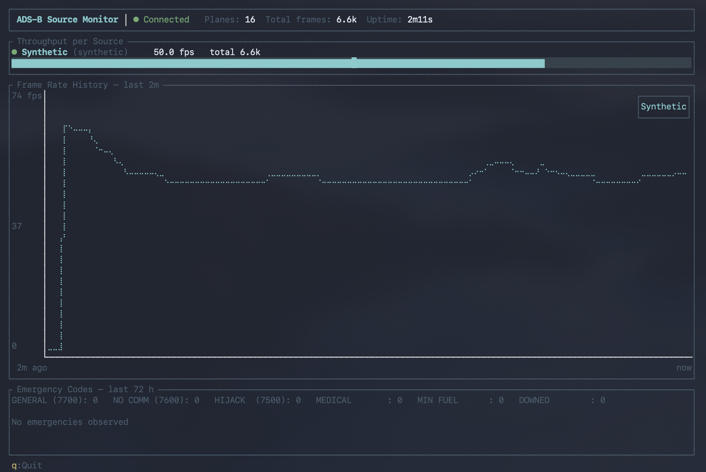

# ADS-B Router

ADS-B Plane Tracking Service - Connects to multiple dump1090-fa instances, consolidates aircraft data, and exposes it via gRPC.



## What it does

Aircraft constantly broadcast who they are, where they are, how high and how fast they are flying (ADS-B). A cheap radio receiver running dump1090-fa can pick up these signals, but each receiver only sees part of the sky, and the raw data is a stream of small, cryptic radio messages.

ADS-B Router sits between your receivers and your applications:

- **It combines several receivers into one picture.** Connect as many dump1090-fa receivers as you like. When two receivers hear the same message, it is counted only once, so you get a single, clean list of aircraft instead of duplicates.
- **It turns radio messages into aircraft.** For every aircraft it keeps an up-to-date record: identity (ICAO address and callsign), position, altitude, speed, heading, climb or descent rate, squawk code, and aircraft category (airliner, light aircraft, helicopter, glider, drone, ...).
- **It keeps positions trustworthy.** Positions are decoded with the standard global and local CPR methods, and implausible jumps (e.g. an aircraft suddenly appearing hundreds of kilometres away) are detected and discarded. Positions derived from multilateration (MLAT) are flagged as such.
- **It watches for emergencies.** Emergency squawks (7700 general emergency, 7600 radio failure, 7500 hijack) and other emergency states are recorded and kept for 72 hours.
- **It cleans up after itself.** Aircraft that haven't been heard from for 3 minutes are removed automatically, and lost receiver connections are retried every 5 seconds.
- **It serves the data to your apps.** Applications connect over gRPC and can fetch a snapshot of all aircraft, subscribe to a live stream of changes (with configurable throttling to save bandwidth), or stream health metrics about the router and its receivers.
- **It can run without any hardware.** Test mode simulates 16 aircraft of different kinds flying over Switzerland, so you can develop and demo without an antenna.
- **It comes with a terminal dashboard.** `adsb-terminal` shows, live, how many messages per second each receiver delivers, a frame-rate history chart, the number of tracked aircraft, and any emergencies from the last 72 hours.

## Features

- **Multi-source support**: Connect to multiple dump1090-fa receivers simultaneously
- **Message deduplication**: Intelligently deduplicates messages across sources
- **Automatic cleanup**: Removes stale aircraft (3 minute timeout)
- **gRPC streaming API**: Real-time updates via gRPC
- **MLAT detection**: Automatically detects and flags MLAT positions
- **CPR position decoding**: Full support for global and local CPR position decoding
- **Hex code filtering**: Configure aircraft to ignore by ICAO hex code
- **Test mode**: Built-in synthetic data generator for testing
- **Position jump detection**: Rejects implausible position updates caused by CPR ambiguity or bad frames
- **Emergency tracking**: Logs emergency squawks and status transitions for 72 hours
- **Metrics streaming**: Per-source frame rates, totals, plane count and uptime via `StreamMetrics`
- **Terminal UI**: `adsb-terminal`, a ratatui dashboard for monitoring a running router

## Usage

### Basic Usage

```bash
# Connect to a single dump1090-fa instance
adsb-router --source 192.168.1.100:30005

# Connect to multiple instances
adsb-router --source 192.168.1.100 --source 192.168.1.101

# Use a config file
adsb-router --config config.toml
```

### Test Mode

Test mode generates synthetic aircraft data for testing and demonstration purposes without requiring actual ADS-B receivers.

```bash
# Run in test mode
adsb-router --test-mode

# Run in test mode with custom gRPC port
adsb-router --test-mode --grpc-addr 0.0.0.0:50052
```

#### Synthetic Aircraft Details

Test mode generates 16 aircraft of various types flying circular patterns over Switzerland:

**Category Set A (Surface/Airborne):**

| Category | Count | Callsigns | Circle Diameter | Speed | Altitude Range | Climb Rate |
|----------|-------|-----------|-----------------|-------|----------------|------------|
| Heavy | 2 | SWR100, SWR200 | 100 km | 450-460 kts | 28,000-38,000 ft | 1400-1500 fpm |
| Medium2 | 2 | EZY101, EZY202 | 60 km | 380-390 kts | 20,000-30,000 ft | 1700-1800 fpm |
| Medium1 | 1 | BEE101 | 40 km | 280 kts | 15,000-22,000 ft | 1200 fpm |
| Light | 2 | HB001, HB002 | 20 km | 160-180 kts | 4,000-12,000 ft | 700-800 fpm |
| High Performance | 1 | EAGLE1 (Swiss AF F/A-18) | 100 km | 700 kts | 30,000-50,000 ft | 5000 fpm |
| Rotorcraft | 1 | HELI1 | 10 km | 120 kts | 1,000-5,000 ft | 500 fpm |

**Category Set B (Special Use):**

| Category | Count | Callsigns | Circle Diameter | Speed | Altitude Range | Climb Rate |
|----------|-------|-----------|-----------------|-------|----------------|------------|
| Glider | 1 | GLIDE1 | 30 km | 90 kts | 3,000-15,000 ft | 300 fpm |
| UAV | 1 | DRONE1 | 10 km | 50 kts | 500-3,000 ft | 400 fpm |
| Ultralight | 1 | UL001 | 15 km | 70 kts | 2,000-8,000 ft | 500 fpm |
| LighterThanAir | 1 | BALN1 | 4 km | 15 kts | 1,000-4,000 ft | 200 fpm |
| Rotorcraft | 1 | HELI2 | 1.5 km | 12 kts | 800-3,500 ft | 180 fpm |
| Parachutist | 1 | JUMP1 | 2 km | 25 kts | 1,500-8,000 ft | 600 fpm |
| Space | 1 | RECON1 | 150 km | 410 kts | 60,000-70,000 ft | 2000 fpm |

All aircraft follow this altitude cycle:
1. **Climb** from min to max altitude at specified climb rate
2. **Cruise** at max altitude for 60 seconds
3. **Descend** to min altitude at same rate
4. **Cruise** at min altitude for 60 seconds
5. Repeat

The aircraft are distributed across Switzerland and their circular paths may overlap, simulating real-world traffic patterns.

### Terminal UI (adsb-terminal)

`adsb-terminal` connects to a running router and shows a live dashboard:

- **Header**: connection state, number of tracked planes, total frames received and router uptime
- **Throughput per Source**: current frames per second and total frames for each receiver
- **Frame Rate History**: chart of frames per second per receiver; on connect it is backfilled with up to 5 hours of history at 1-minute resolution, then updated every second
- **Emergency Codes**: counts per emergency type and a list of emergencies seen in the last 72 hours

```bash
# Connect to a router on localhost (default: http://localhost:50051)
adsb-terminal

# Connect to a remote router
adsb-terminal --addr http://192.168.1.50:50051
```

Press `q` or `Esc` to quit.

### Configuration

Create a `config.toml` file based on `config.example.toml`:

```toml
# gRPC server configuration
[grpc]
listen_addr = "0.0.0.0:50051"
update_interval_ms = 500

# Logging configuration
[logging]
level = "info"

# Filter configuration
[filters]
# Ignore specific aircraft by ICAO hex code
ignore_hex_codes = ["445566", "AABBCC"]

# ADS-B data sources
[[sources]]
host = "192.168.1.100"
port = 30005
name = "Primary Receiver"

[[sources]]
host = "192.168.1.101"
port = 30005
name = "Secondary Receiver"
```

### Command Line Options

```
Options:
  -c, --config <CONFIG>              Path to TOML configuration file
  -s, --source <SOURCES>             ADS-B sources to connect to (format: host:port or host for default port 30005)
  -g, --grpc-addr <GRPC_ADDR>        gRPC server listen address [default: 0.0.0.0:50051]
  -l, --log-level <LOG_LEVEL>        Log level (trace, debug, info, warn, error) [default: info]
      --test-mode                    Enable test mode with synthetic aircraft data
  -h, --help                         Print help
  -V, --version                      Print version
```

## Building

Requires a Rust toolchain and `cmake` (used to build the bundled protobuf compiler; on macOS: `brew install cmake`).

```bash
# Debug build
cargo build

# Release build
cargo build --release

# Run tests
cargo test
```

## gRPC API

The service exposes a gRPC API for accessing aircraft data. See `proto/adsb.proto` for the full API definition.

| RPC | Description |
|-----|-------------|
| `GetAllPlanes` | Snapshot of all currently tracked aircraft |
| `StreamUpdates` | Live stream of aircraft changes, throttled per aircraft |
| `GetStatus` | Service status and source connection info |
| `StreamMetrics` | Periodic metrics snapshots (per-source fps, totals, emergencies, uptime) |

### Example: Streaming Updates

```bash
# Using grpcurl
grpcurl -plaintext -import-path proto -proto adsb.proto \
  localhost:50051 adsb.PlaneTrackingService/StreamUpdates
```

## Architecture

- **Beast Protocol Decoder** (`beast.rs`): Decodes Beast binary protocol from dump1090-fa
- **ADS-B Message Decoder** (`adsb.rs`): Extracts aircraft information from ADS-B messages
- **State Manager** (`state.rs`): Maintains consolidated aircraft state with CPR position decoding
- **Connection Manager** (`connection.rs`): Manages TCP connections to multiple receivers with auto-reconnect
- **gRPC Service** (`grpc.rs`): Exposes aircraft data via gRPC
- **Synthetic Generator** (`synthetic.rs`): Generates realistic test data
- **Terminal UI** (`bin/adsb_terminal/`): ratatui dashboard consuming `StreamMetrics`

## License

See LICENSE file for details.
